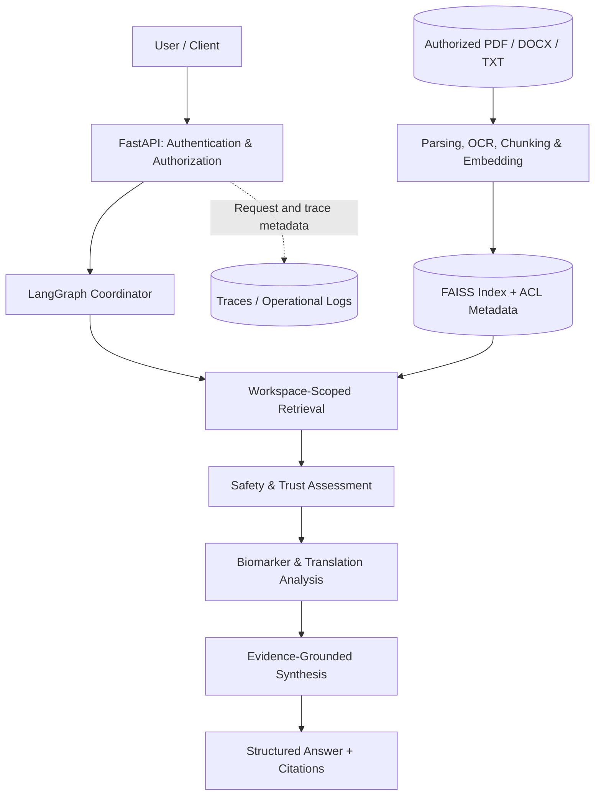

# OncoPilot-AI v2.0

### Evidence-grounded oncology research with multi-agent RAG

**LangGraph · FastAPI · Gradio · FAISS · Sentence Transformers · Python**

[](https://www.python.org/) [](#architecture) [](#whats-new-in-v20) [](#responsible-use-and-limitations)

> **From literature to evidence to actionable research insight.** OncoPilot-AI is a modular, LangGraph-orchestrated oncology evidence copilot that retrieves authorized biomedical documents, evaluates their relevance and trustworthiness, and produces structured answers with traceable supporting evidence.

**Status:** Production-oriented research software, **not** a clinically validated medical device or a certified production deployment. The included Gradio interface is for local development; authenticated deployment is designed around the FastAPI service.

## Why OncoPilot-AI?

Oncology questions often require synthesizing findings across papers, molecular mechanisms, biomarkers, resistance pathways, and translational evidence. General-purpose LLMs may provide plausible explanations without reliable source attribution. OncoPilot-AI combines retrieval, specialized analysis, safety checks, and evidence-oriented synthesis to make its reasoning easier to inspect and validate.

**Example questions**

- Which molecular mechanisms drive resistance to EGFR inhibitors in non-small-cell lung cancer?
- What evidence supports a proposed predictive biomarker?
- How might a molecular finding inform translational research priorities, and where is the evidence limited?

## Key capabilities

| Capability | v2.0 implementation |
|---|---|
| **Multi-agent orchestration** | LangGraph workflow with coordinator, literature, safety, trust, biomarker, translation, and synthesis components |
| **Evidence retrieval** | Sentence-transformer embeddings, FAISS vector index, filtering, and reranking |
| **Document ingestion** | Text-based PDF, scanned PDF with OCR fallback, DOCX, and TXT |
| **Provenance** | Source metadata, file hash, ingestion details, sensitivity classification, and access metadata |
| **Access boundaries** | Workspace-specific indexes, document-level ACL checks, and JWT-capable API authentication |
| **Sensitive-data controls** | Configurable restrictions on transmitting `phi` or `restricted` source passages to external LLMs |
| **Developer interfaces** | FastAPI endpoints and a local Gradio Q&A interface |
| **Engineering foundations** | Pytest suites, health/readiness endpoints, tracing, Dockerfile, and CI configuration |

## Architecture



**Important boundary:** Retrieval filters document permissions **before** source passages are provided to downstream agents. The diagram is a conceptual overview of the workflow, not a claim that every agent runs in a separate service.

### Agent responsibilities

1. **Coordinator:** Organizes the oncology question and workflow context.
2. **Literature/retrieval:** Collects relevant passages from the authorized workspace index.
3. **Safety:** Identifies potentially sensitive or unsafe handling conditions.
4. **Trust:** Evaluates evidence quality and confidence-related signals.
5. **Biomarker:** Interprets molecular and biomarker implications.
6. **Translation:** Frames translational research relevance and limitations.
7. **Synthesis:** Produces the final evidence-oriented response.

Agent execution and actual behavior should be inspected in `src/oncopilot_ai/workflows/langgraph_workflow.py` and `src/oncopilot_ai/agents/`.

## What's new in v2.0?

Compared with the original research prototype, v2.0 adds production-oriented foundations:

- Workspace-scoped document ingestion and FAISS indexes.
- Document sensitivity labels, role/user ACL metadata, and authorization-aware retrieval.
- Multi-format ingestion with scanned-PDF OCR fallback.
- JWT-capable FastAPI access patterns and development-only identity headers.
- Trace privacy controls, operational endpoints, and broader regression-test coverage.
- Deployment, security, and evaluation guidance.

See [`docs/CHANGELOG_v2.0.md`](docs/CHANGELOG_v2.0.md) and [`docs/PRODUCTION_READINESS.md`](docs/PRODUCTION_READINESS.md) for details and outstanding release work.

## Quick start

### 1. Prerequisites

- Python 3.11 recommended (match your CI environment).
- Git and a Python virtual environment.
- Tesseract OCR for scanned PDFs (`brew install tesseract` on macOS).
- An OpenAI API key for workflows that call an external model.

### 2. Install

```bash
git clone <YOUR-REPOSITORY-URL>
cd <ONCOPILOT-PROJECT-DIRECTORY>
python3.11 -m venv .venv
source .venv/bin/activate
python -m pip install --upgrade pip
python -m pip install -r requirements.txt
python -m pip install -e .
python -m pip check
```

Replace the placeholders with the repository URL and project directory that actually contain this code. On Windows, use `.venv\\Scripts\\activate`.

### 3. Configure

```bash
cp .env.example .env
```

Edit `.env` for your local environment:

```dotenv
APP_ENV=development
AUTH_MODE=dev
OPENAI_API_KEY=YOUR_LOCAL_SECRET
OPENAI_MODEL=gpt-5.2
EMBEDDING_MODEL_NAME=sentence-transformers/all-MiniLM-L6-v2
ALLOW_EXTERNAL_LLM_FOR_SENSITIVE=false
```

Use a model your API account supports. **Never commit `.env` or real credentials.** `AUTH_MODE=dev` is only for isolated local testing, not public access.

### 4. Ingest documents

Place authorized test documents in:

```text
data/workspaces/research-team/incoming/
```

Build the index:

```bash
python run_ingest.py \
  --workspace research-team \
  --sensitivity internal \
  --roles researcher,clinician
```

For protected records, classify them appropriately (`phi` or `restricted`) and validate organizational policies before processing them. Do not upload real patient data to a development environment.

### 5. Start the API

```bash
python -m uvicorn app.main:app --host 127.0.0.1 --port 8000
```

Open [FastAPI interactive docs](http://127.0.0.1:8000/docs), or test:

```bash
curl http://127.0.0.1:8000/ping
curl http://127.0.0.1:8000/health
```

For a local development request:

```bash
curl -X POST http://127.0.0.1:8000/ask \
  -H 'Content-Type: application/json' \
  -H 'X-User-ID: demo-researcher' \
  -H 'X-Workspace-ID: research-team' \
  -H 'X-Roles: researcher' \
  -d '{"question":"What mechanisms of EGFR inhibitor resistance are supported by the indexed evidence?","disease":"NSCLC","gene":"EGFR"}'
```

The `X-*` identity headers are **development-only**. Production deployments must use verified JWTs with correctly configured `JWT_ISSUER`, `JWT_AUDIENCE`, and `JWT_JWKS_URL`.

### 6. Start the local Gradio UI

In a separate terminal with the environment activated:

```bash
python run_gradio.py
```

Open the local address printed by Gradio (typically `http://127.0.0.1:7860`). **The v2.0 Gradio UI does not include username/password login or Clinical/Research group selection.** Do not expose it directly to untrusted users.

## Testing and verification

```bash
python -m pytest --collect-only -q
python -m pytest -v
python -m pytest tests/test_security.py tests/test_tracing_privacy.py -v
```

Review failures, skips, and environment-dependent tests before release. The repository includes tests for document loading, chunking, security, tracing privacy, workflow behavior, and API behavior. **No passing test count or benchmark score is claimed here.**

The `eval/run_eval.py` script currently provides an **evaluation harness skeleton** and sample golden cases, not a completed quantitative evaluation. For an evidence-based release gate, add expert-curated cases and score retrieval, citation support, groundedness, abstention, and unauthorized-access leakage.

## API surface

| Endpoint | Purpose |
|---|---|
| `GET /ping` | Lightweight liveness check |
| `GET /health` | Application health/configuration response |
| `GET /ready` | Authenticated readiness check |
| `POST /ask` | Authenticated oncology question answering |
| `GET /trace/{trace_id}` | Authenticated trace retrieval |
| `GET /graph` | Admin-restricted workflow graph information |

## Project structure

```text
app/                        # FastAPI and local Gradio interfaces
src/oncopilot_ai/
  agents/                    # Specialized biomedical agents
  workflows/                 # LangGraph orchestration
  ingestion/                 # Parsing, OCR, chunks, embeddings, indexing
  retrieval/                 # FAISS search, filtering, reranking
  security.py                # Identity and document authorization
tests/                       # Unit and integration tests
eval/                        # Golden cases and evaluation scaffold
docs/                        # Changelog and production-readiness guidance
data/sample_docs/            # Example research documents
run_ingest.py                # Workspace index builder
run_local_api.py             # Local API launcher
run_gradio.py                # Local Gradio launcher
Dockerfile                   # Container build definition
```

## Production engineering and roadmap

v2.0 is a **production-oriented foundation**, not a declaration of operational readiness. Areas requiring deployment-specific validation include:

- **Observability:** centralized logs, metrics, alerts, and trace retention.
- **Security:** production identity integration, end-to-end session management, and independent authorization testing.
- **Verification:** expert-reviewed citations, adversarial testing, and safety/abstention benchmarks.
- **Reliability:** timeout/retry policies, graceful degradation, and load testing.
- **Cost & latency:** measured token usage, request budgets, and p95 latency targets.
- **Scalability:** multi-worker-safe rate limits, shared storage, and deployment testing.
- **Governance:** documented retention, access review, clinical-use boundaries, and human oversight.

**Planned enhancement:** Clinical/Research login and group-aware UI authorization. This feature is **not included in the original v2.0**.

## Responsible use and limitations

OncoPilot-AI is intended for biomedical research, evidence exploration, and engineering demonstrations. Generated answers may contain omissions, incorrect interpretations, or unsupported claims. **It must not be used as a substitute for qualified clinical judgment, patient-specific diagnosis, or treatment decisions.** Human review is required for consequential uses. This project does not claim HIPAA compliance, regulatory clearance, or clinical validation.

## Contributing

Issues and pull requests are welcome. For substantial changes, describe the use case, expected behavior, security implications, and validation evidence. Do not submit real patient information, API keys, or sensitive organizational data.

## License

No license is asserted in this README. Add a `LICENSE` file and an explicit license section once the repository owner selects terms. Until then, the repository should not be assumed to grant open-source reuse rights.

---

**OncoPilot-AI v2.0** · Evidence first · Authorization before retrieval · Verification before trust
